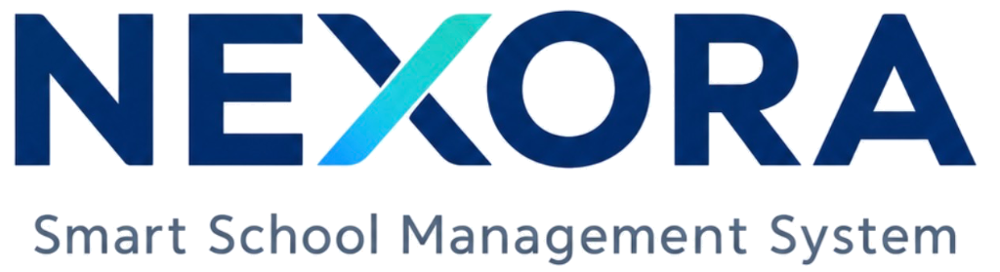

<p align="center">
  
</p>

<h1 align="center">Nexora — Enterprise School Management System</h1>

<p align="center">
  <a href="https://dotnet.microsoft.com/"></a>
  <a href="https://dotnet.microsoft.com/apps/maui"></a>
  <a href="https://dotnet.microsoft.com/apps/aspnet"></a>
  <a href="https://www.postgresql.org/"></a>
  <a href="LICENSE"></a>
  
</p>

> **Nexora** is an enterprise-grade, multi-tenant School Management System engineered with **.NET MAUI**, **ASP.NET Core 10**, and **PostgreSQL 16**. Designed for primary, secondary, and bilingual K-12 institutions, Nexora unifies academic scheduling, class attendance, grading, fee settlements, and cross-platform mobile access for administrators, teachers, students, and parents.

---

## 🌟 Key Modules & Capabilities

### 🏫 Multi-Tenant School Administration
- **Strict Data Isolation**: Multi-tenant database design using EF Core Global Query Filters ensuring complete tenant separation.
- **Academic Hierarchy**: Manage multiple campuses, academic years, semesters, grade levels (Grade 10–12), and class sections (e.g. Class 10-A, Class 10-B).
- **Audit Trails & Security**: Granular audit logging tracking entity modifications, attendance updates, and fee payments.

### 🔐 Zero-Trust Identity & Role-Based Access Control (RBAC)
- **Token-Based Authentication**: Secure JWT access tokens with refresh token rotation and BCrypt password hashing.
- **5 Distinct User Roles**:
  - `SuperAdmin`: Multi-school platform administration and global tenant provisioning.
  - `SchoolAdmin`: Operational oversight, admissions, billing, staff, and timetable setup.
  - `Teacher`: Homeroom advisory control, subject roll call, and assessment score entry.
  - `Student`: Academic dashboard, class timetable, presence inspection, and report cards.
  - `Parent`: Linked children profiles, daily presence alerts, and tuition payment histories.

### 👨‍🎓 Student Lifecycle & Admissions
- **Standardized Admissions**: Automated admission numbering (`ADM-YYYY-####`), enrollment records, and active cohort tracking.
- **Demographic Profiles**: National ID, date of birth, residential addresses, emergency contacts, and family relations.
- **Parent-Child Linkage**: Multiple children mapped under single parent profiles with quick profile switching in the client app.

### 👩‍🏫 Faculty & Teaching Workloads
- **Teacher Directory**: Employee IDs (`EMP-#####`), academic qualifications, subject specializations, and contact details.
- **Class Teacher Assignments**: Designated Homeroom Advisors with administrative authority over assigned student cohorts.

### 📅 Collision-Free Timetable Scheduling Engine
- **Automated Collision Detection**: Algorithmic validation preventing scheduling conflicts:
  - Teacher overlapping periods
  - Room occupancy collisions
  - Class section period clashes
- **Weekly Schedule Visualizer**: Multi-day grid supporting custom period time slots (08:00–09:30, 10:00–11:30, etc.).

### 📋 Session-Based Attendance Management
- **Subject-Level Roll Call**: Take attendance by individual teaching session or daily homeroom period.
- **Role-Aware Permissions**:
  - *Main Advisor & Instructor*: Full attendance editing authority.
  - *Faculty / Viewing Mode*: Read-only inspection for classes instructed by other teachers.
- **Status Lifecycle**: `Present`, `Late`, `Excused`, `Absent` with custom session remarks.
- **Parent Absence Requests**: Parents can submit excuse notes (Medical, Family, Official Event) directly from the mobile app.
- **Real-Time Presence Rates**: Instant calculation of presence percentage based on active roll call items.

### 📊 Authoritative Academic Grading & Report Cards
- **Configurable Assessment Components**: Weighted components (e.g., Attendance 10%, Homework 20%, Midterm 30%, Final 40%).
- **Automated GPA & Letter Grades**: Standard 4.0 GPA scale conversion (`A`, `B`, `C`, `D`, `E`, `F`) with credit weighting.
- **Term Report Cards**: Automated generation of student report cards with teacher remarks and subject score breakdowns.

### 💳 Invoicing, Billing & Fee Settlements
- **Tuition Schedules**: Tuition invoices with due dates, payment categories, and discount tracking.
- **Payment Processing**: Full and partial payment recordings with payment method tagging (ABA Pay, Wing, Bakong, Cash, Bank Transfer).
- **Financial Receipts**: Automated receipt number generation (`REC-YYYY-####`) and outstanding balance tracking.

### 📱 Modern Cross-Platform .NET MAUI Client
- **Targets**: macOS (MacCatalyst), iOS, and Android.
- **MVVM Architecture**: Built using `CommunityToolkit.Mvvm` with observable properties, commands, and dependency injection.
- **Adaptive UI**: Responsive layouts, clean card styling, role-specific bottom tab navigation, and animated status badges.
- **Interactive Splash Screen & Quick Role Switcher**: One-tap demo role selector for instant switching during evaluation.

---

## 🏗️ Clean Architecture & Solution Structure

Nexora follows **Clean Architecture** and **Domain-Driven Design (DDD)** principles:

```text
assignment-student-management/
├── src/
│   ├── Nexora.Domain/          # Core Domain: Entities, Enums, Domain Exceptions, Business Invariants
│   │   ├── Entities/           # Student, Teacher, School, ClassSection, AttendanceRecord, Grade, Invoice
│   │   └── Enums/              # UserRole, AttendanceStatus, GradeScale, InvoiceStatus, PaymentMethod
│   ├── Nexora.Application/     # Application Layer: Use Cases, DTOs, Interfaces, FluentValidation
│   │   ├── DTOs/               # Data Transfer Objects across all functional areas
│   │   └── Interfaces/         # Service contracts (IAttendanceService, IGradeService, IInvoiceService)
│   ├── Nexora.Infrastructure/  # Infrastructure Layer: EF Core 10, PostgreSQL, JWT Auth, Database Seeder
│   │   ├── Data/               # NexoraDbContext, Query Filters, Entity Configurations, DatabaseSeeder
│   │   ├── Migrations/         # EF Core Schema Migrations
│   │   └── Services/           # Service implementations, TokenProvider, PasswordHasher
│   ├── Nexora.Api/             # Presentation / REST API: ASP.NET Core 10, Endpoints, Swagger OpenAPI
│   │   ├── Controllers/        # RESTful API controllers
│   │   └── Middleware/         # Exception handling, JWT authentication, tenant resolver
│   └── Nexora.Mobile/          # Presentation / Client: .NET MAUI Cross-Platform App
│       ├── Views/              # XAML pages (Attendance, Classes, Grades, Dashboard, Timetables, Fees)
│       ├── ViewModels/         # MVVM ViewModels with CommunityToolkit.Mvvm
│       ├── Services/           # Mobile API client, offline mock fallbacks, authentication state
│       └── Resources/          # Icons, vectors, styles, color palettes, fonts
├── tests/
│   ├── Nexora.Tests.Unit/        # 41 Unit tests (GPA computation, timetable collisions, billing, security)
│   └── Nexora.Tests.Integration/ # 7 Integration tests (WebApplicationFactory, API endpoints, auth flow)
├── docs/                       # Technical Specifications & Architecture Documentation
│   ├── architecture.md         # Detailed architectural design and component diagrams
│   ├── database.md             # PostgreSQL schema, relationships, and ERD documentation
│   ├── api.md                  # Comprehensive REST API endpoint reference
│   ├── security.md             # RBAC matrices, authentication mechanisms, and encryption
│   ├── deployment.md           # Production Docker & cloud hosting guide
│   └── implementation-status.md# Module completion checklist and audit
├── docker-compose.yml          # PostgreSQL 16 & ASP.NET Core API container orchestration
└── .env.example                # Environment variables template
```

For complete technical specifications, see:
- [System Architecture](docs/architecture.md)
- [Database Schema & ERD](docs/database.md)
- [REST API Specification](docs/api.md)
- [Security & Reliability](docs/security.md)
- [Deployment Guide](docs/deployment.md)
- [Implementation Status](docs/implementation-status.md)

---

## 🚀 Quick Start Guide

### Prerequisites
- [.NET 10.0 SDK](https://dotnet.microsoft.com/download/dotnet/10.0) (v10.0.402 or later)
- [Docker Desktop](https://www.docker.com/products/docker-desktop/) (Docker 28.0+ / Compose v2.20+)
- Xcode 16+ (for iOS simulator and MacCatalyst compilation on macOS)
- Android SDK / Android Studio (optional, for Android emulator testing)

---

### Option 1: Run with Docker Compose (Recommended for Backend)

```bash
# 1. Clone the repository
git clone https://github.com/Vuthy-Tourn/school-manangement-system.git
cd school-manangement-system

# 2. Configure environment variables
cp .env.example .env

# 3. Spin up PostgreSQL 16 and ASP.NET Core 10 API
docker compose up -d --build
```

The database container automatically applies migrations and seeds initial test data.
- **Swagger OpenAPI:** [http://localhost:5180/swagger](http://localhost:5180/swagger)
- **API Health Check:** [http://localhost:5180/health](http://localhost:5180/health)

---

### Option 2: Run Backend Locally with .NET CLI

```bash
# 1. Start PostgreSQL (e.g. via Docker)
docker run -d --name nexora-postgres -e POSTGRES_PASSWORD=postgres -e POSTGRES_DB=nexora_db -p 5432:5432 postgres:16-alpine

# 2. Apply EF Core Migrations
dotnet ef database update --project src/Nexora.Infrastructure --startup-project src/Nexora.Api

# 3. Run the API
dotnet run --project src/Nexora.Api/Nexora.Api.csproj
```

---

### Option 3: Launch the .NET MAUI Client App

The mobile client includes an offline mock fallback, allowing you to test and navigate all views immediately even before connecting to the live backend:

```bash
# Run on macOS (MacCatalyst)
dotnet run --project src/Nexora.Mobile/Nexora.Mobile.csproj -f net10.0-maccatalyst

# Run on iOS Simulator
dotnet build src/Nexora.Mobile/Nexora.Mobile.csproj -f net10.0-ios

# Run on Android
dotnet build src/Nexora.Mobile/Nexora.Mobile.csproj -f net10.0-android
```

---

## 🔑 Pre-Seeded Demo Credentials

The mobile login screen includes **1-Tap Quick Role Selectors** for instant testing without typing. You can also sign in manually using these accounts:

| Role | Username | Email | Password | Scope & Responsibilities |
| :--- | :--- | :--- | :--- | :--- |
| **Super Admin** | `superadmin` | `superadmin@nexora.cloud` | `Admin@123!` | Multi-tenant school management and system oversight |
| **School Admin** | `admin` | `admin@angkoracademy.edu.kh` | `Admin@123!` | School operations, admissions, billing, timetables, and staff |
| **Teacher (Advisor)** | `teacher.dara` | `dara.sok@angkoracademy.edu.kh` | `Teacher@123!` | Class 10-A Homeroom Advisor, Mathematics instructor, attendance roll call |
| **Teacher (Faculty)** | `teacher.chenda` | `chenda.chan@angkoracademy.edu.kh` | `Teacher@123!` | Physics instructor, subject grades entry, timetable schedules |
| **Student** | `student.visal` | `visal.chan@student.angkoracademy.edu.kh` | `Student@123!` | Student dashboard, Class 10-A attendance history, report cards, fee tracking |
| **Parent** | `parent.bopha` | `bopha.keo@parent.angkoracademy.edu.kh` | `Parent@123!` | Child monitoring (Visal Chan), absence excuse slips, invoice settlements |

---

## 🧪 Automated Testing

All business rules, GPA algorithms, timetable collision detection, fee settlement rules, and API security boundaries are verified through automated tests:

```bash
# Run all 48 solution tests
dotnet test Nexora.sln

# Run unit tests only (41 tests)
dotnet test tests/Nexora.Tests.Unit/Nexora.Tests.Unit.csproj

# Run API integration tests only (7 tests)
dotnet test tests/Nexora.Tests.Integration/Nexora.Tests.Integration.csproj
```

### Test Results
```text
Passed!  - Failed: 0, Passed: 41, Skipped: 0, Total: 41 (Nexora.Tests.Unit.dll)
Passed!  - Failed: 0, Passed:  7, Skipped: 0, Total:  7 (Nexora.Tests.Integration.dll)
Total: 48 / 48 Tests Passed (100% Success Rate)
```

---

## 🛠️ Technology Stack

| Layer | Technologies |
| :--- | :--- |
| **Mobile Client** | .NET MAUI 10.0, CommunityToolkit.Mvvm, XAML, SkiaSharp / Material Components |
| **Backend API** | ASP.NET Core 10.0, Minimal APIs / Controllers, Swagger / Swashbuckle |
| **ORM & Database** | Entity Framework Core 10, Npgsql PostgreSQL Provider, PostgreSQL 16 |
| **Security & Auth** | JWT Bearer, Refresh Tokens, BCrypt.Net-Next, Claims-based Authorization |
| **Testing** | xUnit, FluentAssertions, Moq, Microsoft.AspNetCore.Mvc.Testing, Respawn |
| **DevOps & Containers** | Docker, Docker Compose, Multi-stage Dockerfile |

---

## 📄 License

This project is licensed under the MIT License - see the [LICENSE](LICENSE) file for details.
