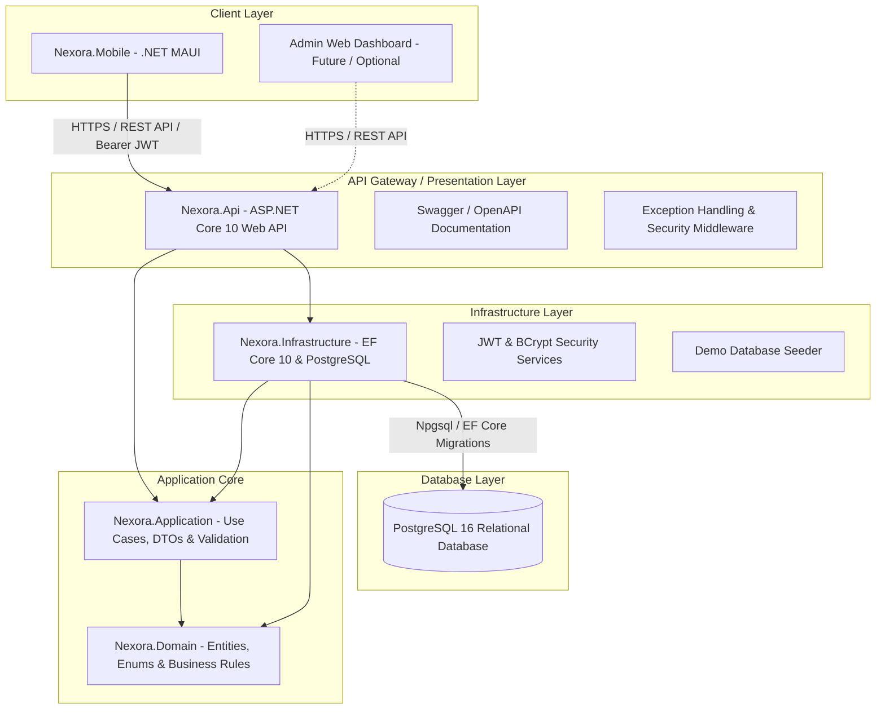
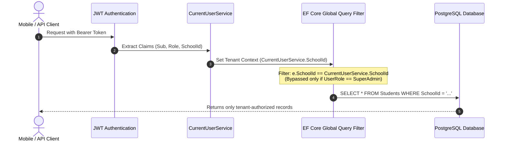

# Nexora — System Architecture & Design Documentation

## 1. Overview
**Nexora** is an enterprise-grade School Management System architected for high reliability, multi-tenant isolation, and intuitive cross-platform mobile access. Built for schools, private academies, and training centers in Cambodia and internationally, Nexora centralizes student admissions, staff scheduling, timetabling, daily attendance, authoritative exam grading, and fee invoicing.

---

## 2. Architectural Paradigm
Nexora adopts **Clean Architecture** (Ports and Adapters / Onion Architecture) combined with **Domain-Driven Design (DDD)** principles and the **MVVM (Model-View-ViewModel)** presentation pattern on mobile devices.

---

## 3. Project Structure & Layer Responsibilities

### 3.1. `Nexora.Domain`
- **Role:** Pure core business domain containing enterprise entities, enums, and invariant business rules.
- **Dependencies:** None. Zero external NuGet or framework dependencies.
- **Key Artifacts:**
  - `Entities`: `School`, `User`, `RefreshToken`, `Student`, `Teacher`, `ParentGuardian`, `StudentGuardian`, `AcademicYear`, `Semester`, `GradeLevel`, `ClassSection`, `Subject`, `SubjectClassAssignment`, `StudentEnrollment`, `TimetableEntry`, `AttendanceRecord`, `Exam`, `AssessmentComponent`, `GradeScale`, `StudentGrade`, `FeeCategory`, `Invoice`, `InvoiceItem`, `Payment`, `Announcement`, `AnnouncementReadReceipt`, `Notification`, `AuditLog`.
  - `Enums`: `UserRole`, `StudentStatus`, `EnrollmentStatus`, `AttendanceStatus`, `InvoiceStatus`, `PaymentMethod`, `AnnouncementTarget`, `AnnouncementPriority`, `NotificationType`, `AuditAction`.

### 3.2. `Nexora.Application`
- **Role:** Application business logic, use cases, transfer objects, data validation, and interface contracts.
- **Dependencies:** Depends strictly on `Nexora.Domain` and `FluentValidation`.
- **Key Artifacts:**
  - `Interfaces`: `IApplicationDbContext`, `IAuthService`, `IStudentService`, `ITeacherService`, `IAcademicService`, `ITimetableService`, `IAttendanceService`, `IGradeService`, `IFeeService`, `IAnnouncementService`, `IDashboardService`, `IReportService`, `IAuditLogService`, `ICurrentUserService`, `IJwtTokenService`, `IPasswordHasher`, `IDateTimeProvider`.
  - `DTOs`: Strongly-typed input and output contracts for all functional modules, preventing raw entity leakage.
  - `Validators`: FluentValidation validators enforcing field constraints, email formats, score ranges, and Cambodian phone patterns (`+855` / `0xx`).

### 3.3. `Nexora.Infrastructure`
- **Role:** Implements data access, external integrations, security hashing, JWT generation, and database context.
- **Dependencies:** `Nexora.Application`, `Nexora.Domain`, `Npgsql.EntityFrameworkCore.PostgreSQL`, `BCrypt.Net-Next`, `System.IdentityModel.Tokens.Jwt`.
- **Key Artifacts:**
  - `ApplicationDbContext`: EF Core context configured with PostgreSQL conventions, foreign key cascade/restrict rules, and **Global Query Filters** for multi-tenant data isolation.
  - Services: High-performance async service implementations executing database transactions, conflict detection, weighted GPA calculations, and audit logging.
  - `DatabaseSeeder`: Automatically seeds realistic institutional structures, courses, and accounts for demonstration and testing.

### 3.4. `Nexora.Api`
- **Role:** The HTTP entry point and API hosting tier.
- **Dependencies:** `Nexora.Infrastructure`, `Nexora.Application`, `Nexora.Domain`, `Microsoft.AspNetCore.Authentication.JwtBearer`, `Swashbuckle.AspNetCore`, `Serilog.AspNetCore`.
- **Key Features:**
  - RESTful Controllers adhering to standard HTTP verbs and status codes (200, 201, 204, 400, 401, 403, 404, 500).
  - RFC 7807 ProblemDetails format for consistent client error handling via `ExceptionHandlingMiddleware`.
  - JWT Bearer Authentication with claims (`UserId`, `Email`, `Role`, `SchoolId`).
  - Native Health Checks (`/health`) with live DB connectivity verification.

### 3.5. `Nexora.Mobile`
- **Role:** Cross-platform .NET MAUI native mobile application targeting Android, iOS, and macOS (MacCatalyst).
- **Dependencies:** `Nexora.Application`, `Nexora.Domain`, `CommunityToolkit.Mvvm`, `Microsoft.Extensions.Http`.
- **Key Features:**
  - MVVM Architecture with `[ObservableProperty]` and `[RelayCommand]` code generators.
  - `ApiService`: Typed HTTP client managing JWT token attachment, refresh token rotation, connection retries, and offline fallback.
  - Role-adaptive dashboards and screens: Administrator, Teacher, Student, Parent, and Super Administrator views.
  - Bilingual UI readiness (English and Khmer).

### 3.6. `Nexora.Tests.Unit` & `Nexora.Tests.Integration`
- **Role:** Comprehensive automated test suites.
- **Unit Tests:** Validates core domain calculations (authoritative GPA calculation, grade scale mapping, invoice balance recalculation, partial payments, timetable collision detection, BCrypt hashing, FluentValidation rules).
- **Integration Tests:** Utilizes `WebApplicationFactory<Program>` with an isolated in-memory test database to verify security boundaries, JWT auth, tenant isolation, role forbidding, and API endpoints end-to-end.

---

## 4. Multi-Tenant Architecture & Data Isolation

Nexora employs a **shared database, tenant-discriminator model** via the `SchoolId` foreign key on all tenant-scoped entities.

### Security Invariants:
1. Every query executed through `ApplicationDbContext` automatically appends `WHERE SchoolId = @CurrentSchoolId` via EF Core global query filters.
2. Even if a malicious actor specifies another institution's ID in a URL or payload, the query filter prevents reading or updating the foreign record.
3. Only the `SuperAdmin` role is permitted to bypass the tenant filter for global institutional oversight.

---

## 5. Security & Authentication Flow

1. **Authentication:** Clients authenticate against `POST /api/v1/auth/login` using username/email and password.
2. **Password Verification:** Passwords are verified using **BCrypt** with salted adaptive cost hashing.
3. **Token Issuance:** Successful logins issue a cryptographically signed JWT access token (120 minutes lifetime) and a secure random refresh token (7 days lifetime).
4. **Token Refresh:** When access tokens expire, clients call `POST /api/v1/auth/refresh-token` with their refresh token to obtain a new access token without re-entering credentials.
5. **Revocation & Logout:** Logging out immediately revokes the active refresh token.
