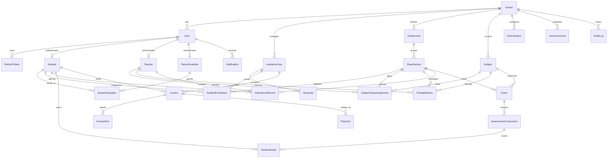

# Nexora — Relational Database Design & Schema Specification

## 1. Overview
Nexora utilizes **PostgreSQL 16** managed via **Entity Framework Core 10** Code-First migrations. The schema is normalized (Third Normal Form - 3NF) with strict primary and foreign key constraints, explicit indexing on frequently filtered columns (`SchoolId`, `AdmissionNumber`, `EnrollmentStatus`, `Date`), and soft/restrictive delete behaviors to safeguard academic and financial audit integrity.

---

## 2. Mermaid Entity-Relationship Diagram (ERD)

---

## 3. Core Database Entities

### 3.1. Tenant & Security
- **`Schools` (`tenants`)**: Primary tenant record (`Id`, `Name`, `Code`, `Address`, `ContactPhone`, `ContactEmail`, `Timezone`, `Currency`, `IsActive`, `SubscriptionTier`).
- **`Users`**: Application user credentials (`Id`, `SchoolId`, `Username`, `Email`, `PasswordHash`, `FirstName`, `LastName`, `Role`, `PhoneNumber`, `IsActive`, `CreatedAtUtc`).
- **`RefreshTokens`**: Rotating security tokens (`Id`, `UserId`, `Token`, `ExpiresUtc`, `IsRevoked`, `ReplacedByToken`).

### 3.2. People & Guardianship
- **`Students`**: Student demographic and admission data (`Id`, `SchoolId`, `UserId`, `AdmissionNumber`, `FirstName`, `LastName`, `Gender`, `DateOfBirth`, `Address`, `EmergencyContactName`, `EmergencyContactPhone`, `EnrollmentDate`, `Status`).
- **`Teachers`**: Faculty records (`Id`, `SchoolId`, `UserId`, `EmployeeNumber`, `FirstName`, `LastName`, `Specialization`, `Qualification`, `HireDate`, `IsActive`).
- **`ParentGuardians`**: Parent and guardian accounts (`Id`, `SchoolId`, `UserId`, `FirstName`, `LastName`, `RelationshipToStudent`, `PhoneNumber`, `Address`).
- **`StudentGuardians`**: Many-to-many junction (`StudentId`, `GuardianId`, `IsPrimaryContact`).

### 3.3. Academic Structure
- **`AcademicYears`**: School calendar years (`Id`, `SchoolId`, `Name`, `StartDate`, `EndDate`, `IsCurrent`).
- **`Semesters`**: Terms within an academic year (`Id`, `AcademicYearId`, `Name`, `StartDate`, `EndDate`, `IsActive`).
- **`GradeLevels`**: Educational levels (`Id`, `SchoolId`, `Name`, `Code`, `OrderIndex`).
- **`ClassSections`**: Class cohorts (`Id`, `GradeLevelId`, `AcademicYearId`, `HomeRoomTeacherId`, `Name`, `RoomNumber`, `Capacity`).
- **`Subjects`**: Curricular subjects (`Id`, `SchoolId`, `Name`, `Code`, `CreditHours`).
- **`SubjectClassAssignments`**: Teacher-to-subject-to-class allocation (`Id`, `ClassSectionId`, `SubjectId`, `TeacherId`).
- **`StudentEnrollments`**: Student class placement (`Id`, `StudentId`, `ClassSectionId`, `AcademicYearId`, `EnrollmentDate`, `RollNumber`, `Status`).

### 3.4. Timetables & Attendance
- **`TimetableEntries`**: Schedule slots with day-of-week, time ranges, and room assignment (`Id`, `ClassSectionId`, `SubjectId`, `TeacherId`, `DayOfWeek`, `StartTime`, `EndTime`, `RoomNumber`).
- **`AttendanceRecords`**: Daily per-student class attendance (`Id`, `ClassSectionId`, `StudentId`, `Date`, `Status` [Present, Absent, Late, Excused], `Remarks`, `RecordedByTeacherId`, `RecordedAtUtc`).
  - *Unique Index:* `(ClassSectionId, StudentId, Date)` prevents duplicate daily attendance entries.

### 3.5. Assessments & Authoritative Grading
- **`Exams`**: Academic examinations (`Id`, `SemesterId`, `SubjectId`, `ClassSectionId`, `Title`, `ExamDate`, `IsPublished`).
- **`AssessmentComponents`**: Weighted scoring parts e.g. Midterm 40%, Final 60% (`Id`, `ExamId`, `Name`, `MaxMarks`, `WeightPercentage`).
- **`GradeScales`**: Configurable institutional grade thresholds (`Id`, `SchoolId`, `Letter`, `MinimumPercentage`, `GradePoint`, `Description`).
- **`StudentGrades`**: Recorded marks (`Id`, `AssessmentComponentId`, `StudentId`, `Score`, `RecordedByUserId`, `RecordedAtUtc`, `AuditTrail`).

### 3.6. Financial Management
- **`FeeCategories`**: Tuition, registration, laboratory, library (`Id`, `SchoolId`, `Name`, `Description`, `DefaultAmount`).
- **`Invoices`**: Student invoices (`Id`, `SchoolId`, `StudentId`, `AcademicYearId`, `InvoiceNumber`, `IssueDate`, `DueDate`, `TotalAmount`, `PaidAmount`, `BalanceAmount`, `Status` [Pending, Partial, Paid, Cancelled, Overdue]).
- **`InvoiceItems`**: Itemized charges (`Id`, `InvoiceId`, `FeeCategoryId`, `Description`, `Amount`).
- **`Payments`**: Payment settlements (`Id`, `InvoiceId`, `ReceiptNumber`, `Amount`, `PaymentDateUtc`, `PaymentMethod` [Cash, ABA_Pay, Wing, BankTransfer, Cheque], `ReferenceNumber`, `ReceivedByUserId`).

### 3.7. Communications & Governance
- **`Announcements`**: Broadcast messages (`Id`, `SchoolId`, `Title`, `Content`, `Target` [All, Teachers, Students, Parents, SpecificClass], `Priority`, `PublishDateUtc`, `IsActive`).
- **`AuditLogs`**: Immutable system audit records (`Id`, `SchoolId`, `UserId`, `Username`, `Action`, `EntityName`, `EntityId`, `Details`, `TimestampUtc`, `IpAddress`).

---

## 4. Timezone & Monetary Integrity
1. **Timestamp Storage:** All date/time timestamps (`CreatedAtUtc`, `RecordedAtUtc`, `TimestampUtc`, `ExpiresUtc`) are stored strictly in **UTC (`timestamptz`)**.
2. **Display Timezone:** Dates are converted for display using the school's configured timezone (defaults to **`Asia/Phnom_Penh`**).
3. **Monetary Precision:** All currency fields (`TotalAmount`, `PaidAmount`, `BalanceAmount`, `Score`) utilize `decimal(18,2)` with bank rounding.
4. **Financial Transactions:** Invoices and payments are wrapped in explicit database transactions; payments automatically recalculate and synchronize the parent invoice's `PaidAmount`, `BalanceAmount`, and `Status`.

---

## 5. Seed Data Summary
The database includes automated seeding (`DatabaseSeeder.cs`) that provisions:
- **Tenant:** Angkor International Academy (`tenant-angkor-001`)
- **Accounts:**
  - `superadmin` (`superadmin@nexora.edu.kh` / `SuperAdmin123!`)
  - `admin` (`admin@angkor.edu.kh` / `Admin123!`)
  - `teacher` (`teacher.somnang@angkor.edu.kh` / `Teacher123!`)
  - `student` (`student.dara@angkor.edu.kh` / `Student123!`)
  - `parent` (`parent.sophal@angkor.edu.kh` / `Parent123!`)
- **Academic Structure:** Academic Year 2026-2027, Semester 1, Grade 10, Classes 10-A and 10-B, Mathematics, English Literature, Khmer Studies, Physics, Chemistry.
- **Data:** Realistic schedules, past 5 days attendance, midterm exams, grade scales (A, B, C, D, E, F), published grades, invoices, and ABA Pay receipts.
